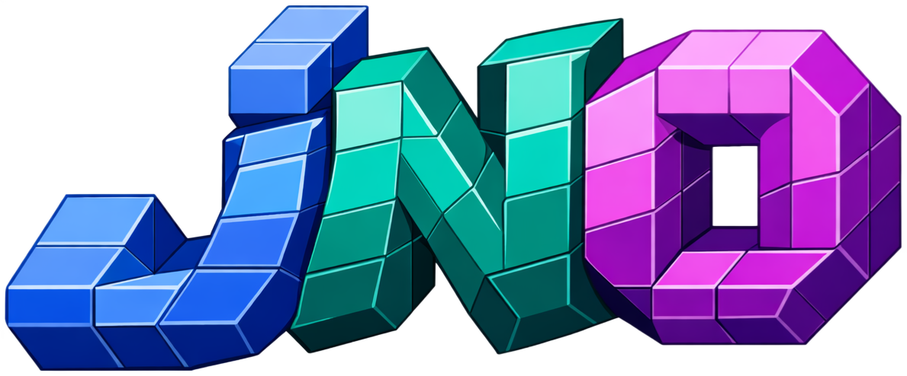

<p align="center">
  
</p>

<p align="center">
    <a href="https://fhg-iisb.github.io/jNO/">
        
    </a>
    <a href="LICENSE">
        
    </a>
    <a href="CITATION.cff">
        
    </a>
    
    <a href="https://arxiv.org/abs/2605.10159">
        
    </a>
</p>

[Install](#install) · [Examples](#examples) · [Features](#features) · [Docs](https://fhg-iisb.github.io/jNO/) · [Citation](#citation)

**jNO** (jax Numerical Operators) is a JAX library for **differentiable numerical methods**.
Finite elements, finite differences and RCWA sit next to PINNs, neural operators and Bayesian
inference on one substrate: you write the math (a weak form, a stencil, a residual, a loss) and it
becomes one `jit`-compiled, GPU-ready graph that is differentiable end to end. An inverse problem,
a design optimisation or a neural coefficient is therefore one composition away from a forward solve.

> [!NOTE]
> Research code under active development; the API may still change between minor versions. Each
> docs page states its scope and known limits.

## Install

```bash
pip install jax-numerical-operators              # CPU; FEM, FDM, solvers and SciML included
pip install "jax-numerical-operators[cuda,fem]"  # + NVIDIA GPU, remeshing, PARDISO/cuDSS, METIS
```

Other extras: `[rcwa]`, `[amg]` (GPU multigrid), `[iree]`. For the newest features install from
`main`: `pip install git+https://github.com/FhG-IISB/jNO`. Pixi, Docker and CUDA pinning are in the
[installation guide](https://fhg-iisb.github.io/jNO/Installation/).

## Examples

Each example is complete and runs as shown on a CPU.

<details open>
<summary><strong>Topology optimisation</strong>: a SIMP cantilever, with gradients through the FEM solve</summary>

```python
import jax
jax.config.update("jax_enable_x64", True)
import jax.numpy as jnp
import numpy as np
import jno

L, H, VF, LAM, MU = 60.0, 30.0, 0.4, 0.33, 0.38          # plane-stress Lamé constants, E = 1
d = jno.shape.rect(0, 0, L, H, size=1.0).domain()
x, y, _ = d.variable("interior", split=True)
xl, yl, _ = d.variable("left", split=True)               # clamped root
xt, yt, _ = d.variable("tip", where=lambda x, y: (x > L - 1e-6) & (y < 2 + 1e-6), split=True)

u = d.unknown.vector(2); v = u.test()
rho = jno.np.parameter(d.unknown.scalar(space="P0", name="r").test(), name="rho")  # one density per element
rho.initialize(jax.nn.initializers.constant(VF))
rho.optimizer(jno.optimizers.mma(move=0.15, lower=1e-3, upper=1.0))
rho.constrain(d.patch_filter())                          # no checkerboards, no one-node hinges

eps = lambda w: jno.np.symgrad(w, [x, y])
a = lambda e1, e2: LAM * jno.np.trace(e1) * jno.np.trace(e2) + 2 * MU * jno.np.inner(e1, e2, n_contract=2)
E = 1e-9 + rho**3                                        # SIMP interpolation

fem = jno.fem([E * a(eps(u), eps(v)),                    # ∫ E(ρ) σ(u):ε(v)
               u(xl, yl) - (0.0, 0.0),
               jno.np.inner(jnp.array([0.0, 0.5]), v.bind(x=xt, y=yt))])   # downward tip load

compliance = (E * a(eps(u), eps(u))).integrate(fem)      # the objective, through the solve
volume = (rho.reshape(-1) * d.cell_volume()).sum / (VF * L * H)
crux = jno.core([compliance, jno.le(volume, 1.0)],       # minimise C subject to V ≤ 40 %
                domain=jno.domain.from_array({"_": np.zeros((1, 1))}))
crux.solve(150)                                          # → a crisp truss, volume exactly at the bound
```

No sensitivity is derived by hand: `fem.solve()` is a node of the graph, so MMA gets dC/dρ from
autodiff. The [deformable-mesh tutorial](https://fhg-iisb.github.io/jNO/tutorials/08-fem-and-varpinns/topology-optimisation-cantilever/)
also moves the mesh nodes as design variables.

</details>

<details>
<summary><strong>Inverse problem</strong>: recover a whole conductivity field from one measurement</summary>

```python
import jax
import jax.numpy as jnp
import optax
import jno

d = jno.shape.rect(0, 0, 1, 1, size=0.1).domain()
x, y, _ = d.variable("interior", split=True)
xb, yb, _ = d.variable("boundary", split=True)
u = d.unknown(); v = u.test()
grad = lambda w: jno.np.jacobian(w, [x, y])
f = 30 * (x * (1 - x) + y * (1 - y))

def forward(k):                                          # −∇·(k∇u) = f,  u = 0 on ∂Ω
    return jno.fem([k * jno.np.inner(grad(u), grad(v)) - f * v, u(xb, yb) - 0.0], quad_degree=3).solve()

# Synthetic data from a hidden inclusion ...
k_true = lambda x, y: 1 + 0.8 * jnp.exp(-((x - 0.5) ** 2 + (y - 0.5) ** 2) / 0.03)
u_obs = jnp.asarray(forward(jno.np.parameter(v).initialize(k_true).freeze()))

# ... and the whole nodal field k(x) recovered from it, through the solve.
k = jno.np.parameter(v, name="k").initialize(jax.nn.initializers.constant(1.0))
k.optimizer(optax.adam(2e-2))
crux = jno.core([(forward(k) - u_obs).mse,                 # data misfit
                 1e-3 * k.regularize("h1seminorm").mean])  # smoothness prior
crux.solve(500)                                            # k(x) to 6 % relative L2
```

Swap `k` for a scalar, the mesh coordinates, or a network `jno.nn(net)`; the structure stays the same.

</details>

<details>
<summary><strong>Coupled multiphysics</strong>: Rayleigh–Bénard convection, transient and nonlinear</summary>

```python
import jax
jax.config.update("jax_enable_x64", True)
import numpy as np
import jno

Pr, Ra = 1.0, 1.0e4                                      # Ra ≫ Ra_c ≈ 1708: the layer must convect
d = jno.shape.rect(0, 0, 2, 1, size=0.11).domain(time=(0, 0.234, 27))
x, y, t = d.variable("interior", split=True)
xb, yb, _ = d.variable("boundary", split=True)
x0, y0, _ = d.variable("initial", split=True)

u = d.unknown.vector(2, order=2)                         # P2 velocity ┐ Taylor–Hood
p = d.unknown.scalar(name="p")                           # P1 pressure ┘
T = d.unknown.scalar(name="T")                           # P1 temperature
v, q, s = u.test(), p.test(), T.test()

grad = lambda w: jno.np.jacobian(w, [x, y])
div = lambda w: jno.np.trace(grad(w))
dot, ddot = jno.np.inner, lambda a, b: jno.np.inner(a, b, n_contract=2)
dt = lambda w: w.bind(x=x, y=y, t=t).t

fem = jno.fem([
    dot(dt(u), v) + dot(dot(grad(u), u), v) + Pr * ddot(grad(u), grad(v))   # ∂ₜu + (u·∇)u − Pr Δu
      - p * div(v) - Pr * Ra * T * v[1],                 #   + ∇p = Pr Ra T ê_y
    -q * div(u),                                         # ∇·u = 0
    dt(T) * s + dot(u, grad(T)) * s + dot(grad(T), grad(s)),   # ∂ₜT + u·∇T = ΔT
    u(xb, yb) - 0.0, T(xb, yb) - (1 - yb), p.pin(),      # no slip, hot floor, cold lid
    u(x0, y0) - 0.0,                                     # start at rest, slightly perturbed
    T(x0, y0) - (1 - y0 + 0.05 * jno.np.sin(np.pi * x0) * jno.np.sin(np.pi * y0)),
])
sol = fem.solve(linear=jno.solve.lu())                   # backward Euler + Newton per step
traj = np.asarray(jno.core([sol.mse]).eval([sol]))       # (27, 2398): one row per time step
# peak |u| 27.7: started at rest, ends in two counter-rotating rolls
```

Nothing selects a mode: `fem.solve()` reads the time derivative and the nonlinearity off the terms.

</details>

<details>
<summary><strong>Electromagnetics</strong>: resonant modes of a 3-D cavity with Nédélec edge elements</summary>

```python
import jax
jax.config.update("jax_enable_x64", True)
import numpy as np
import jno

d = jno.shape.box(0, 0, 0, 1, 1, 1, size=0.35).domain()
x, y, z, _ = d.variable("interior", split=True)
E = d.unknown.vector(3, space="N1E", order=2); F = E.test()   # 2nd-order H(curl) elements
curl = lambda w: w.vector.curl(x, y, z)

K = jno.fem([jno.np.inner(curl(E), curl(F)),                   # ∇×∇×E = k² E
             E.vector.cross(d.variable("boundary", normals=True))])   # PEC wall: n×E = 0
k2, modes = K.eigs(mass=[jno.np.inner(E.bind(x=x, y=y, z=z), F.bind(x=x, y=y, z=z))],
                   k=6, sigma=25.0)                            # shift-invert near k² = 25
print(np.sort(np.asarray(k2)) / np.pi**2)                      # [2.00 2.00 2.00 3.00 3.00 4.93]
```

The analytic spectrum is k² = π²(l² + m² + n²). Edge elements send the gradient fields to k² = 0,
so no spurious modes appear between the physical ones.

</details>

<details>
<summary><strong>Diffraction grating</strong>: RCWA from the same Helmholtz term list</summary>

```python
import jax
jax.config.update("jax_enable_x64", True)
import jax.numpy as jnp
import jno

K0, P = 2 * jnp.pi, 1.5                                  # λ = 1, period Λ = 1.5 λ
d = jno.shape.box(0, 0, 0, P, 0.3, 1.0, size=0.25).domain()
for tag, f in {"bottom": lambda x, y, z: z < 1e-6, "top": lambda x, y, z: z > 1 - 1e-6,
               "left": lambda x, y, z: x < 1e-6, "right": lambda x, y, z: x > P - 1e-6,
               "front": lambda x, y, z: y < 1e-6, "back": lambda x, y, z: y > 0.3 - 1e-6}.items():
    d.tag(tag, f)
x, y, z, _ = d.variable("interior", split=True)
u = d.unknown(); v = u.test()

def on(tag):                                             # u and v on a named face
    s = d.variable(tag, split=True)
    return u.bind(x=s[0], y=s[1], z=s[2]), v.bind(x=s[0], y=s[1], z=s[2])
(ut, vt), (ub, vb) = on("top"), on("bottom")

ridge = jno.fn(lambda x, y, z: jnp.where((0.4 < z) & (z < 0.6) & (x < P / 2), 1.0, 0.0), [x, y, z])
eps = 1.0 + 10.0 * ridge                                 # a silicon-like ridge in half of each period

sol = jno.rcwa([
    jno.np.inner(jno.np.jacobian(u, [x, y, z]), jno.np.jacobian(v, [x, y, z])) - K0**2 * eps * u * v,
    -(1j * K0 * ut) * vt,                                # outgoing radiation (top)
    -(1j * K0 * ub - 2j * K0) * vb,                      # incident plane wave + radiation (bottom)
    on("left")[0] - on("right")[0], on("front")[0] - on("back")[0],   # Floquet periodicity
], orders=160).solve()

sol.efficiency("R"), sol.efficiency("T")                 # 0.840, 0.160: R + T = 1
sol.order(-1, 0), sol.order(+1, 0)                       # 0.073 each: the ±1 orders now propagate
```

`jno.rcwa` reads the period, layer stack, permittivity and incidence off the terms (needs `[rcwa]`).

</details>

<details>
<summary><strong>PINN</strong>: natural convection in a heated cavity, every boundary condition hard-constrained</summary>

```python
import jax
jax.config.update("jax_enable_x64", True)                 # the quasi-Newton phase needs float64
import numpy as np
import optax
import foundax
import jno

Pr, Ra = 0.71, 1.0e3                                      # de Vahl Davis (1983) benchmark
d = jno.shape.rect(0, 0, 1, 1).structured(n=32).domain()
x, y, _ = d.variable("interior", split=True)

mlp = lambda key: jno.nn(foundax.mlp(2, hidden_dims=32, num_layers=3, activation=jax.nn.tanh,
                                     key=jax.random.PRNGKey(key)))
nets = net_psi, net_p, net_T = mlp(0), mlp(1), mlp(2)
for net in nets:
    net.optimizer(jno.optimizers.soap(optax.exponential_decay(3e-3, 2000, 0.5, end_value=1e-5)))

# u = ∇×ψ with ψ = 0 and ∂ψ/∂n = 0 on the walls: no slip and ∇·u = 0 hold exactly.
psi = (256 * (x * (1 - x) * y * (1 - y)) ** 2 * net_psi(x, y)).scalar.bind(x=x, y=y)
p = (Ra * Pr * net_p(x, y)).scalar.bind(x=x, y=y)
# T = 1 on the hot wall, 0 on the cold one; T sees y only through cos(πy), so ∂T/∂y = 0 on floor and lid.
T = ((1 - x) + x * (1 - x) * net_T(x, jno.np.cos(np.pi * y))).scalar.bind(x=x, y=y)

u, v = psi.d(y), -psi.d(x)
dx, dy, lap = (lambda f: f.d(x)), (lambda f: f.d(y)), (lambda f: f.d2(x) + f.d2(y))
crux = jno.core([                                         # strong form, scaled to O(1)
    ((u * dx(u) + v * dy(u) + dx(p) - Pr * lap(u)) / (Ra * Pr)).mse,       # x-momentum
    ((u * dx(v) + v * dy(v) + dy(p) - Pr * lap(v)) / (Ra * Pr) - T).mse,   # y-momentum: buoyancy T → u
    (u * dx(T) + v * dy(T) - lap(T)).mse,                                  # energy: advection u → T
], domain=d)

crux.solve(15_000)                                        # SOAP
for net in nets:
    net.optimizer(jno.optimizers.ssbroyden())            # then self-scaled Broyden (quasi-Newton)
crux.solve(1_000)
# u_max 3.650, v_max 3.692, Nu 1.117   (benchmark: 3.649, 3.697, 1.118)
```

No boundary loss is needed: the ansatz satisfies every condition, so the loss is the physics alone.
SOAP and SSBroyden are part of `jno.optimizers`; together they bring the residual to ~1e-7.

</details>

<details>
<summary><strong>Operator learning</strong>: an FNO trained on the PDE residual alone, with no solution data</summary>

```python
import foundax
import optax
import jno

jno.setup("./runs/pino", diff_type="spectral")            # differentiate the FNO output on its grid
N = 64
dom = 256 * jno.shape.rect(0, 0, 1, 1, size=1 / N).structured().domain()   # 256 samples
x, y, _ = dom.variable("interior", split=True)
f = jno.noise.grf(x, y, length_scale=0.2)                # a fresh random forcing every batch

net = jno.nn(foundax.fno2d(in_features=1, hidden_channels=32, n_modes=16, d_model=(N + 1, N + 1)))
net.optimizer(optax.adam(1e-3))
u = net(f).bind(x=x, y=y)

crux = jno.core([(u.xx + u.yy + f).mse], domain=dom)     # learn f ↦ u for −Δu = f
crux.solve(epochs=20_000, batchsize=8)
```

The operator is trained on the physics alone. Data losses, DeepONet, transformers and LoRA
fine-tuning plug into the same `jno.core`.

</details>

## Features

<details>
<summary>What is in jNO, with maturity and a docs page per area (click to expand)</summary>

<br>

| Area | What is there | Maturity |
|---|---|---|
| [FEM](https://fhg-iisb.github.io/jNO/fem/) | Lagrange P1–Pk on triangles and tets (quads and hexes in beta); scalar, vector, matrix and constant unknowns; complex fields; steady, transient, 2nd order in time | stable |
| [Elements](https://fhg-iisb.github.io/jNO/fem/elements/) | Nédélec (N1E, N2E) and Raviart–Thomas of any degree; Hermite, Argyris, Morley (C¹ plates); P0 | experimental |
| [Coupling & constraints](https://fhg-iisb.github.io/jNO/fem/geometry/) | periodic and Bloch ties, mortar ties between non-matching meshes, contact, moving meshes (ALE) | beta |
| [Adaptivity](https://fhg-iisb.github.io/jNO/fem/geometry/) | h (anisotropic remeshing), r and p adaptivity | beta |
| [FDM](https://fhg-iisb.github.io/jNO/fdm/) | strong form on structured and unstructured grids, 2-D and 3-D, geometric multigrid | stable |
| [RCWA](https://fhg-iisb.github.io/jNO/rcwa/) | vector Maxwell, anisotropic media, diffraction orders, Jones readout | stable |
| [PEEC](https://fhg-iisb.github.io/jNO/peec/) | partial-element equivalent circuits: inductance and resistance of conductor layouts, DC to MHz | beta |
| [Solvers](https://fhg-iisb.github.io/jNO/solvers/) | sparse LU (SuperLU, PARDISO, cuDSS), Krylov, AMG, AMS, Schwarz; Newton; eigenproblems (LOBPCG, shift-invert, Arnoldi) | stable |
| [Time integration](https://fhg-iisb.github.io/jNO/solvers/) | θ-method, BDF2, SDIRK, Rosenbrock, exponential, adaptive steps | stable |
| [Inverse & design](https://fhg-iisb.github.io/jNO/inverse-problems/) | gradients through any solve: coefficients, fields, geometry, topology optimisation (MMA) | stable |
| [Geometry](https://fhg-iisb.github.io/jNO/Domain-and-Geometry/) | CSG via gmsh-OCC, multi-material regions, signed distance, mesh import | stable |
| [Domain decomposition](https://fhg-iisb.github.io/jNO/domain-decomposition/) | FEM, FDM and PINN subdomains in one problem | beta |
| [PINNs](https://fhg-iisb.github.io/jNO/tutorials/01-basics/laplace-1d/) | forward, variational (VPINN, Deep Ritz), stochastic PDEs, adaptive resampling | stable |
| [Operator learning](https://fhg-iisb.github.io/jNO/tutorials/11-operator-learning/) | FNO, DeepONet, U-Net, transformers via [foundax](https://github.com/FhG-IISB/foundax); physics or data losses | stable |
| [Bayesian](https://fhg-iisb.github.io/jNO/training/bayesian/) | NUTS, HMC, MALA, SGLD, VI per parameter | stable |
| [Training tools](https://fhg-iisb.github.io/jNO/model-controls/lora/) | LoRA and PEFT, explainability, data and model parallelism, W&B, checkpointing, IREE export | stable |

</details>

More than 40 worked [tutorials](https://fhg-iisb.github.io/jNO/#tutorials) cover flow (up to
vortex shedding and LES), fracture, elastodynamics, melt pools, droplets, Maxwell, inverse and
Bayesian problems and operator learning.

## Citation

If you use jNO in academic work, please cite:

```bibtex
@article{armbruster2026jno,
  title   = {jNO: A JAX Library for Neural Operator and Foundation Model Training},
  author  = {Armbruster, Leon and Ramesh, Rathan and Kruse, Georg and Straub, Christopher},
  journal = {arXiv preprint arXiv:2605.10159},
  year    = {2026},
  doi     = {10.48550/arXiv.2605.10159},
  url     = {https://arxiv.org/abs/2605.10159}
}
```

## AI Disclosure

Parts of this codebase — including model ports, tests, and documentation — were developed with the assistance of AI coding tools. All contributions are reviewed and tested to the best of our ability, but mistakes may remain; please open an issue if you spot one.
